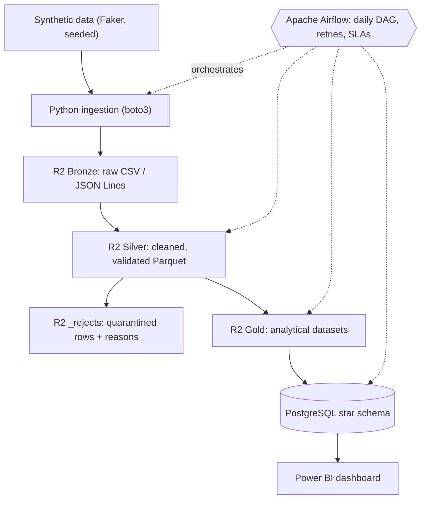
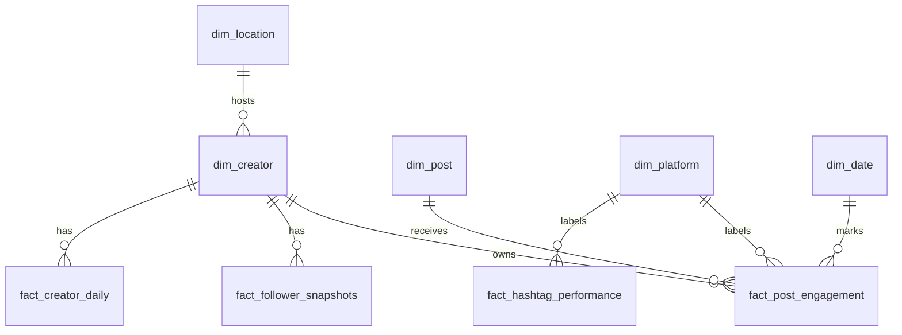

# SocialPulse — Social Media Analytics Data Platform

  

An end-to-end, orchestrated data-engineering pipeline for a fictional Kenyan social media analytics startup:
**generate → ingest → store (Cloudflare R2 medallion lake) → transform → warehouse (PostgreSQL star schema) → visualise (Power BI).**

> _Add your Power BI dashboard screenshot here: `docs/images/dashboard.png`_

## Business problem

SocialPulse helps Kenyan creators and brands (Nairobi, Mombasa, Kisumu, Nakuru, Eldoret, Thika) understand
what works on Instagram, TikTok and X. Raw engagement events arrive messy and in bulk; the business needs
trustworthy answers to six questions:

1. How much engagement does each post earn? 2. Which creators have the best engagement rate?
3. Whose audience is growing fastest? 4. Which platform performs best? 5. Which hashtags drive engagement?
6. When (hour / weekday) should creators post?

## Architecture



| Component | Technology | Role |
|---|---|---|
| Data generation | Python + Faker + NumPy | Simulate users, posts, engagements, followers, hashtags (seeded, reproducible, with injected defects) |
| Ingestion | Python + boto3 | Upload to R2 with metadata, verification and failure logging |
| Data lake | Cloudflare R2 | Bronze / Silver / Gold prefixes in one bucket |
| Processing | pandas + PyArrow + pandera | Clean, validate against data contracts, write Parquet |
| Orchestration | Apache Airflow 2.10 | Daily DAG, retries, SLAs, failure alerts |
| Warehouse | PostgreSQL | Star schema, SCD Type 2 creators, SQL analytics |
| BI | Power BI Desktop | Four-page interactive dashboard |
| Quality | pytest, moto, ruff | Tests against mocked R2 *and* a real PostgreSQL database |

### Why these choices
- **R2 over S3** – zero egress fees and an S3-compatible API (boto3 works unchanged).
- **Airflow over cron** – retries with back-off, dependency graph, SLAs, backfills, observability.
- **Parquet in Silver/Gold** – columnar, typed, compressed; Bronze stays raw so any bug can be replayed.
- **Idempotency everywhere** – every key is `…/ingestion_date=YYYY-MM-DD/…`, generation is seeded, warehouse loads upsert. Re-running a day never duplicates data.
- **Quarantine, don't delete** – rejected rows are written to `silver/_rejects/` with a reason, so `rows_in == rows_out + rows_rejected` always holds and is asserted.

## Data lake layout

```
socialpulse-data-lake/
├── bronze/<entity>/ingestion_date=YYYY-MM-DD/<entity>_<MMDD>.csv|json   # raw, with ingestion metadata
├── silver/<entity>/ingestion_date=YYYY-MM-DD/<entity>.parquet           # cleaned + validated
├── silver/_rejects/<entity>/ingestion_date=…/rejects.parquet            # quarantined rows + reject_reason
├── gold/{creator_performance,post_performance,hashtag_performance,audience_growth}/ingestion_date=…/
└── logs/{ingestion,transformations}/ingestion_date=…/                   # JSON run summaries
```
Bronze object metadata: `ingestion_ts`, `source`, `row_count`, `sha256`, `run_date`. Engagements are **JSON Lines** (one event per line) in a `.json` file.

## Data sources & entities

| Entity | Fields | Notes |
|---|---|---|
| users | user_id, username, city, niche, joined_date | stable universe of creators |
| posts | post_id, user_id, platform, content_type, caption, posted_at | instagram / tiktok / x |
| engagements | engagement_id, post_id, user_id, engagement_type, platform, timestamp | like, comment, share, view (default 10,000/day) |
| followers | user_id, follower_count, snapshot_date | daily snapshot for growth maths |
| hashtags | post_id, hashtag | many per post |

Generators are pure functions of `(seed, date)`. With `INJECT_DIRTY_DATA=true` (default) ≈3 % defects are injected per dataset: duplicate IDs, nulls, `TikTok`/` X `/`Twitter` platform spellings, mixed timestamp formats (`T`/space/`+03:00`/`Z`), orphan foreign keys, negative follower counts, `#Hashtag` variants — so Silver has real work to do.

## Pipeline behaviour & data-quality checks

| Stage | What happens |
|---|---|
| Bronze | Upload, verify size with `HEAD`, attach metadata, write a JSON run summary; any failed entity raises `IngestionError` after the others were attempted |
| Silver | Required-field checks, vocabulary checks, **timestamps → UTC** (naive source times are Nairobi/EAT), de-duplication, **referential integrity** (post→user, engagement→post & user, hashtag→post, follower→user), null fill with logged counts |
| Gates (before writing Silver) | Row reconciliation (Bronze rows = metadata `row_count`; in = out + rejected), **reject-rate circuit breaker** (`MAX_REJECT_RATE`, default 10 %), null-rate thresholds, **pandera schema contracts** |
| Gold | `post_performance`, `creator_performance`, `hashtag_performance`, `audience_growth`; reconciled to Silver (Σ likes+comments+shares) before writing |
| Warehouse | One transaction per day; staging tables + `INSERT … ON CONFLICT DO UPDATE`; SCD2 creators; unmatched dimension keys abort and roll back the whole load; `etl_load_audit` table |

Example (seeded run, 2026-10-29, defaults): engagements 10,300 raw → 9,747 clean + 553 quarantined
(`duplicate_engagement_id` 293, `missing_required_field` 157, `orphan_post_id` 103).

**Definitions** — `total_engagement = likes + comments + shares` (views are *impressions*);
`engagement_rate = total_engagement / followers × 100`; `growth_rate = (current − previous) / previous × 100`.

## Warehouse (star schema)


Dimensions: `dim_creator` (SCD2: surrogate key, `valid_from`/`valid_to`/`is_current`), `dim_platform`, `dim_date`, `dim_post`, `dim_location`.
Facts: `fact_post_engagement`, `fact_follower_snapshots` (as specified) plus `fact_creator_daily` and `fact_hashtag_performance` (added so Power BI's creator-comparison and hashtag pages are served from the warehouse). Facts link to the creator version valid on the fact date.

### Example SQL (full set in [`warehouse/analytics.sql`](warehouse/analytics.sql))
```sql
-- Q4: engagement by platform
SELECT pl.platform_name, count(*) AS posts, sum(f.total_engagement) AS total_engagement,
       round(avg(f.total_engagement), 2) AS avg_engagement_per_post
FROM fact_post_engagement f JOIN dim_platform pl USING (platform_key)
GROUP BY 1 ORDER BY 3 DESC;

-- Q6a: best posting hour (Nairobi time)
SELECT p.posted_hour_eat, round(avg(f.total_engagement), 2) AS avg_engagement
FROM fact_post_engagement f JOIN dim_post p USING (post_key)
GROUP BY 1 ORDER BY 2 DESC;
```

## Repository structure

```
socialpulse/
├── config/            settings.py (env loading, validation) · logging_config.py
├── data_generation/   generate_{users,posts,engagements,followers}.py · dirtiness.py · run_generation.py
├── ingestion/         r2_client.py · upload_data.py · download_data.py
├── transformations/   clean_{users,posts,engagements,followers,hashtags}.py · run_silver.py · build_gold.py
├── quality/           schemas.py (pandera contracts) · checks.py (gates)
├── warehouse/         schema.sql · load_gold.py · analytics.sql
├── dags/              socialpulse_pipeline.py
├── tests/             generation · ingestion · transformations · e2e · warehouse · DAG
├── docs/              powerbi_guide.md
├── sample_data/       one small generated day
├── run_pipeline.py    CLI: single day, stages, or chronological backfill
├── Dockerfile · docker-compose.yaml · Makefile
└── requirements.txt · requirements-dev.txt · .env.example
```

## Setup

**Prerequisites:** Python 3.10+, PostgreSQL 13+, Git, Docker Desktop (for Airflow), Power BI Desktop, a Cloudflare account with R2 enabled (card required; stay inside the free tier: 10 GB, no egress fees).

```bash
git clone https://github.com/<your-username>/socialpulse.git && cd socialpulse
python -m venv .venv && source .venv/bin/activate        # Windows: .venv\Scripts\activate
pip install -r requirements-dev.txt

cp .env.example .env     # R2 → Manage API Tokens → Object Read & Write; fill the 4 R2_* values
createdb socialpulse     # or: docker compose up -d warehouse

# ── MVP (Week 1): generate → Bronze → print the daily engagement summary
python -m data_generation.run_generation --date 2026-10-30
python -m ingestion.upload_data          --date 2026-10-30
python -m ingestion.download_data        --date 2026-10-30 --summary

# ── Full pipeline for one day, or a chronological backfill
python run_pipeline.py --date 2026-10-30
python run_pipeline.py --start 2026-10-01 --end 2026-10-30

# ── Airflow (Docker): UI at http://localhost:8080  (admin/admin – change outside local use)
docker compose up airflow-init && docker compose up -d
#   unpause `socialpulse_pipeline`; backfill: docker compose exec airflow-scheduler \
#   airflow dags backfill socialpulse_pipeline -s 2026-10-01 -e 2026-10-30

# ── Warehouse SQL & dashboard
psql -d socialpulse -f warehouse/analytics.sql          # tables are created by the loader
#   Power BI: see docs/powerbi_guide.md
```

**Tests**
```bash
pytest                                                     # R2 is mocked with moto
TEST_PG_DSN="host=localhost dbname=socialpulse_test user=postgres password=postgres" pytest   # + real PostgreSQL
```
> The warehouse tests drop the `public` schema of `TEST_PG_DSN` — use a throw-away database.

## Security
`.env` is git-ignored; only `.env.example` is committed. If a key ever leaks, **rotate it in Cloudflare immediately** (R2 → Manage API Tokens). Use a token scoped to the single bucket. Change the default Postgres/Airflow passwords for any shared deployment.

## Limitations & design notes (honest engineering)
- **Same-day engagement windows.** The generator emits a post's engagements on the day it was published. Gold `post_performance` reads *all* Silver engagement partitions, so late events are picked up if a day is re-run, but older days are not refreshed automatically.
- **Chronological loads.** SCD2 and growth rates assume dates are loaded in order (`max_active_runs=1`; use `run_pipeline.py --start/--end` for backfills).
- **Local hand-off between Airflow tasks.** `generate → upload_bronze` share `data/` on one machine (fine with `LocalExecutor`). For a distributed executor, mount shared storage or generate straight into R2.
- **Pandas scale.** Comfortable to millions of rows per day. Beyond that, move Silver/Gold to Spark (see roadmap).
- Real social-API ingestion is out of scope; the synthetic generator stands in for it.

## Enhancements roadmap
| Enhancement | Skill demonstrated | Status |
|---|---|---|
| Date-partitioned Parquet | Lake optimisation | ✅ |
| Duplicate-event detection | Data quality | ✅ (de-dup + quarantine) |
| Schema validation (pandera) | Data contracts | ✅ |
| SCD Type 2 creators | Warehousing | ✅ |
| Automated tests | Reliability | ✅ (CI workflow can be added later) |
| Pipeline monitoring & alerting | Observability | ✅ logs/alerts + audit table; Slack/email hook is one function |
| Incremental ingestion (watermark table) | Incremental ETL | roadmap |
| Real social-API ingestion | Source integration | roadmap |
| Spark / Kafka | Scale / streaming | only when volume demands it |

**Cost:** R2 free tier (10 GB, no egress), PostgreSQL / Airflow / Power BI Desktop are free locally. At 10 k engagements/day the lake grows by a few MB per day.

## License
MIT
